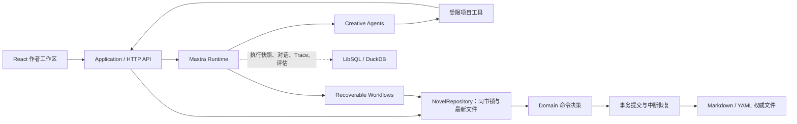

<div align="center">

# ANI 小说 Agent

面向中文长篇网文创作的本地 Agent 工作区。

从一句灵感、阅读偏好或市场信号出发，完成蓝图、章节规划、正文写作、独立验收与持续修订，让作者保留方向选择和内容修改的决定权。

[](https://github.com/ExplosiveCoderflome/ani-book-agent/releases/tag/2026-10-15)


[](LICENSE)

</div>

> [!IMPORTANT]
> 当前优先保证“从零开书到前三章稳定稿”的可靠闭环，支持之后按批续写。全自动开书的授权范围为前三章，暂不承诺无人值守完成整本小说。

[快速开始](#快速开始) · [开书与续写](#开书与续写) · [拆书与机制迁移](#拆书与机制迁移) · [任务恢复](#任务恢复) · [本地数据与升级](#本地数据与升级) · [架构与开发](#架构与开发) · [最新更新](#最新更新)

## 项目定位

长篇创作需要持续守住人物状态、世界规则、章节顺序、节奏和作者已经确认的选择。ANI 小说 Agent 将规划、写作、审查和修订组织成一条可恢复的生产链，作品保存在可阅读的 Markdown/YAML 文件中。

它适合从阅读感觉开始的新手作者、希望长期掌握作品文件的创作者，以及研究 Mastra Agent 与文件型领域模型的开发者。默认通过里程碑协作推进，也可以从市场方向卡进入全自动前三章开书。

## 功能总览

| 能力 | 当前实现 | 使用边界 |
| --- | --- | --- |
| 新手开书 | 选择升级爽感、赚钱经营、智斗破局、关系拉扯、悬疑闯关等阅读感觉，逐步形成 3 个故事种子和 2 份蓝图 | 普通模式由作者选择方向、确认开书资产 |
| 章节生产 | 默认每批续写 3 章，底层单次最多 5 章；依次规划、写作、验收和提交 | 同一本书只有一个活动生产任务，从当前进度串行推进 |
| 独立验收 | Writer 与 Critic 分工，检查连续性、重复、节奏、钩子与实际张力；最多自动重写 2 次 | 仍未通过时停止，保留已提交的稳定章节 |
| 作者工作台 | 文件树、Markdown 可视化/源码编辑、角色状态、Agent 对话、逐行差异和任务状态 | 作者保存的内容进入保护状态，AI 修改须经过审批 |
| 张力曲线 | 全书与分卷目标曲线、拖动与键盘调整、节点锁定、候选对比、实际走势和异常提示 | 标准写作需确认本批次计划与曲线；修改后旧确认失效 |
| 项目审查与导出 | 用自然语言检查人物、节奏、伏笔或指定章节，保存 Markdown 报告；稳定正文可导出 TXT | 审查不自动修改正文，TXT 导出不包含规划与运行数据 |
| 市场趋势 | 番茄、起点、晋江共 6 个公开榜单；历史快照、题材观察、阅读感觉卡和开书入口 | 仅采集公开榜单元数据，不读取作品正文 |
| 长篇拆书 | 本地文本导入、章节切分、分析范围、Token 估算与快速/标准/完整预设 | 启动前确认切分和预算，全局同时只运行一个拆书任务 |
| 结构与机制迁移 | 七大体系、70 维结构雷达；选取 1–3 条推荐洞察，转为规划、写作和审查约束 | 网页默认作用于下一章起的 3 章，作者需审核原创性并批准 |
| 创作 Skill | 7 个官方 Skill，支持派生、新建、导入、校验、试运行、发布、回滚、归档和作品绑定 | 官方 Skill 需先派生再修改；当前试运行不执行脚本 |
| 任务恢复与保护 | 瞬时模型故障自动重试、取消后撤销提交权限、多文件提交回滚与中断恢复 | 文件或授权过期时停止提交，等待作者处理 |

## 快速开始

### 环境要求

- Node.js `22.18.0` 或更高版本；仓库提供 `.nvmrc`。
- pnpm `10.x`。
- 一个可用的模型 API Key。
- Microsoft Edge：仅运行当前 Playwright E2E 时需要。

Windows 支持使用当前用户范围的 DPAPI 加密保存模型密钥。其他系统的密钥仅保留在当前服务进程中，重启后需要重新填写。

### 安装与启动

```powershell
git clone https://github.com/ExplosiveCoderflome/ani-book-agent.git
cd ani-book-agent
corepack enable
pnpm install --frozen-lockfile
pnpm dev
```

| 入口 | 地址 | 用途 |
| --- | --- | --- |
| 作者工作区 | <http://127.0.0.1:5175> | 开书、写作、拆书、市场趋势与 Skill 管理 |
| Mastra Studio/API | <http://127.0.0.1:4111> | 开发调试、运行与观测 |

`pnpm dev` 同时启动 Web 和 Mastra。首次使用直接在页面配置模型，无需复制环境变量文件。

### 连接模型

首次打开页面会显示“模型设置”，之后也可通过设置按钮修改。

1. 选择内置提供商，或“第三方提供商”。
2. 填写 API Key；第三方还需填写 Base URL，通常以 `/v1` 结尾，不包含 `/chat/completions`。
3. 第三方连接需先点击“获取模型”，再从返回列表选择默认模型；更换地址后需重新填写密钥。
4. 可单独选择“拆书分析模型”，留空时依次回退到审查模型、默认模型。
5. 点击“保存”。

界面中的默认模型用于聊天、写作和审查。第三方需支持兼容的 `GET /models` 接口；实际模型能力与费用由提供商决定。

## 开书与续写

### 选择开书方式

| 方式 | 入口 | 执行过程 |
| --- | --- | --- |
| 里程碑协作 | “作品”页新建，或市场卡片“快速开书” | 讨论偏好 → 选择故事种子 → 比较蓝图 → 批准开书资产 → 确认卷计划与曲线 → 生成前三章 |
| 全自动开书 | 市场卡片“全自动开书” | 带入明确方向 → 内部比较原创方案 → 创建开书资产 → 自动生成第 1–3 章；完成或生产失败后退出自动模式 |

市场入口先点击“更新公开榜单”，再点击“生成开书方向”；也可选择历史快照复用已有方向。“快速开书”会带入题材信号并等待作者选择，“全自动开书”会直接推进前三章。

### 跑通前三章

1. 在“作品”页输入临时书名，点击“新建作品”；已有作品时可从“全部作品”返回列表。
2. 在 Agent 对话中选择阅读感觉，补充题材、受众和不希望出现的内容。
3. 从 3 个故事种子中选择、混合或提出修改，再比较 2 份作品蓝图。
4. 检查蓝图、连续性账本、全书张力曲线和角色档案，点击“确认蓝图并规划第一卷”。
5. 查看卷计划与逐章目标曲线，按需调整并保存，再点击“曲线已确认，继续”。
6. 等待章节依次完成写作、独立验收和稳定提交。

```text
蓝图与角色 → 卷计划与目标曲线 → 作者确认
                                  ↓
                     Writer 写作 → Critic 验收
                                  ↓
                     未通过：最多 2 次质量重写
                                  ↓
                 正文、账本、新角色、实际张力一起提交
```

全自动开书使用已明确授予的前三章授权，省去中途确认；质量验收和提交保护仍然生效。

### 继续创作

前三章完成后，在工作台续写下一批，默认再写 3 章。每次标准批次都需要确认当前计划与曲线，已经确认后又修改规划时，需要重新处理确认或规划。

可直接在对话中提出具体要求，例如：

- “检查第 1–3 章的人物动机与连续性，先给报告。”
- “整理目前尚未回收的伏笔，指出对应章节。”
- “为这段正文提出修订方案，保留我修改过的表达。”

项目审查会保存报告；涉及作品修改时，继续通过补丁审批处理。点击“导出”生成正文文件后，在左侧“导出文件”中打开对应文件，再点击“下载 TXT”。

## 拆书与机制迁移

### 分析参考文本

1. 从顶栏进入“拆书库”，导入本地 `.txt`、`.md` 或 `.markdown` 文件；支持 UTF-8/GB18030，单文件 1 字节至 20MiB。
2. 检查章节切分，必要时使用自定义规则或 AI 建议，确认后再启动分析。规则匹配超时会停止校验并保留原有规则。
3. 选择章节范围与分析预设，核对预计调用量、输入/输出 Token 和硬预算，点击“确认预算并开始”。
4. 查看结构化小节、原文证据、结构雷达和推荐洞察；需要时按角色生成深研档案。

| 预设 | 结果范围 |
| --- | --- |
| 快速拆书 | 总览、剧情结构、人物系统、文风与技法 |
| 标准拆书 | 在快速基础上加入世界观、主题和商业化卖点 |
| 完整拆书 | 在标准基础上加入故事时间线 |

三个预设使用同一拆解流程，主要区别是输出小节；“快速”不代表只抽样阅读，分析范围由所选章节决定。当前入口未开放深度专项复扫。

Token 硬预算为 100,000–50,000,000，估算不等于账单或绝对费用上限，预算检查点可能要求追加预算后继续。

### 应用到自己的作品

先完成目标作品的蓝图和账本，再选择 1–3 条推荐洞察，选择目标作品并点击“生成提案”。网页默认从下一章开始作用 3 章；服务端允许指定未来章节范围，单份最多覆盖 20 章。作者批准后，约束才会进入对应章节的规划、写作与审查；批准本身不会启动写章。

生成提案前会移除所选洞察的原文证据字段，并要求模型只迁移抽象机制。模型仍可能产生相似表达或情节，作者批准前应检查专名、设定与情节组合。来源分析或作品规划变化后，提案会过期，需要重新生成。

拆书库不会自行联网获取小说正文。市场趋势独立读取公开榜单元数据；页面改版或来源故障时允许部分失败，排名与 AI 总结只作为创作参考。

## 创作 Skill

官方方法包括 `discovery`、`blueprint`、`character-planning`、`volume-planning`、`chapter-writing`、`critique`、`project-review`。

从顶栏“创作 Skill”进入方法库。修改官方方法需先派生，也可新建或通过目录、ZIP、HTTPS Git 导入；保存草稿后先校验、试运行，再发布。进入作品左侧“项目设置 → 创作方法”，按 Agent、任务和已发布版本绑定。

Skill 支持 `SKILL.md`、`references/`、`scripts/` 和 `assets/`。当前试运行只验证模型如何使用文本方法，不读取或修改真实作品，也不执行脚本；设置 Sandbox 能力变量不会自动接入脚本执行环境。

生产任务记录已解析的 Skill、作者偏好和机制迁移版本。Workspace 仍按当前作品绑定读取资源，尚未对所有资源完全冻结；长任务运行中应避免变更创作方法。作品文件会在提交前检查最新版本，变化可能使当前结果失效。

## 任务恢复

| 当前情况 | 如何处理 |
| --- | --- |
| 模型临时限流、超时或服务端故障 | 系统进行有限自动重试；仍失败时查看提示。密钥、模型名称或上下文错误需先修正原因 |
| 生产任务失败 | 点击任务栏“一键重试”，从当前稳定进度创建新任务；选择“不再重试”可释放占用 |
| 等待曲线确认 | 保存未提交的曲线修改，点击“曲线已确认，继续” |
| 想停止写作或拆书 | 使用当前任务的取消/停止操作；已稳定提交的结果保留，旧运行不能继续提交 |
| 聊天本轮失败 | 使用对话中的“重试本次操作”；它与生产任务“一键重试”是不同入口 |
| 全自动开书尚未创建生产任务 | 使用对话中的“继续全自动开书”，从开书讨论继续 |
| 拆书暂停等待预算 | 核对已用量和后续范围，再选择“追加预算并继续”或取消 |
| 文件版本过期、作者保护或外部编辑冲突 | 重新读取文件、核对差异并处理提示，不要通过删除状态文件绕过保护 |
| 服务在多文件提交期间中断 | 重新启动后首次读取会检查未完成提交；若检测到后续作者编辑，会保留现场并报告冲突 |

刷新页面可恢复已保存的作品、对话和任务状态。服务无法读取运行记录时会阻止继续启动，避免误判旧任务已经结束。当前没有任意位置的手动暂停/恢复功能。

## 作者保护与数据权威

| 数据 | 权威来源 |
| --- | --- |
| 小说生产进度、文件版本和生产授权 | `novel-state.yaml` |
| 蓝图、角色、计划、正文、作者决定 | 版本化 Markdown/YAML |
| 已确认事实、角色状态、世界规则、开放线索 | `book/ledger.yaml` |
| 执行快照、对话记忆、Trace 和评估 | Mastra 存储；不作为小说事实来源 |

Agent 通过受限工具提出补丁，不能直接写权威文件。普通未保护笔记可自动应用；普通模式中的蓝图、账本决定、稳定章节修订和作者保护内容需要审批，全自动开书的完整资产包使用明确授予的开书授权。替换必须匹配当前 SHA-256，曲线锁定节点只有在明确请求覆盖并批准后才能替换。

提案原文登记在作品中，审批必须匹配原提案；重复批准幂等处理。服务端支持持久拒绝，已持久拒绝的提案不能重新应用。**当前 Web 提案面板的“拒绝”或“继续讨论”仅关闭面板，尚未调用持久拒绝接口。**

新章节只能通过已授权的生产提交，只有独立验收通过且顺序、范围、规划确认和文件版本仍有效时才能推进进度。同书操作在一个服务进程内串行，不同作品可并行；多个服务实例不能同时写入同一作品目录。

## 本地数据与升级

### 单书目录

```text
novels/<novel-id>/
├─ novel-state.yaml                    # 进度、授权与文件版本
├─ book/
│  ├─ blueprint.md                     # 作品蓝图
│  ├─ ledger.yaml                      # 连续性账本
│  ├─ tension-curve.yaml                # 全书目标张力
│  └─ characters/*.md                  # 角色档案
├─ volumes/
│  ├─ volume-001.md                    # 分卷计划与章节卡
│  └─ volume-001-tension.yaml           # 分卷目标张力
├─ chapters/chapter-001.md              # 稳定章节
├─ workspace/
│  ├─ ideas.md                         # 灵感便笺
│  ├─ skill-bindings.yaml               # 本书 Skill 绑定
│  ├─ proposals/*.yaml                 # 补丁原文与审批状态
│  ├─ reviews/*.md                     # 项目审查报告
│  ├─ references/adaptations/*.yaml     # 机制迁移提案
│  └─ analysis/*-tension-actual.yaml    # 实际张力与异常诊断
└─ exports/*.txt                       # 导出正文
```

### 默认数据位置

| 目录 | 内容 | Git 默认行为 |
| --- | --- | --- |
| `novels/` | 作品权威文件、版本和导出 | 忽略内容，仅保留 `.gitkeep` |
| `reference-library/` | 导入原文、章节清单与历次分析 | 忽略内容，仅保留 `.gitkeep` |
| `.runtime/` | 模型设置、加密密钥、Mastra 数据库、Skill 版本和资源、对话与观测 | 忽略 |
| `profiles/` | 作者明确选择和反馈的偏好 | 忽略 |
| `market-radar/` | 历史榜单快照及对应的 AI 方向总结 | 忽略 |
| `.mastra/`、`dist/` | 开发与构建产物 | 忽略 |

### 备份与升级

升级前先停止服务，并备份实际使用的数据目录。完整备份应包含作品、拆书库、偏好、市场缓存和 `.runtime/`；只保存导出的 TXT 无法恢复规划、任务、对话或自定义 Skill。Windows 加密密钥绑定当前用户，更换系统或用户后可能需要重新填写。

更新代码、执行 `pnpm install --frozen-lockfile` 并重新启动后：

- 已保存正文和作者文件无需迁移或清空。
- 缺少新生产授权记录的旧活动任务，需要取消后重新启动。
- 未登记到作品中的历史待审批提案，需要重新生成。
- 遇到恢复冲突时保留整个作品目录，包括隐藏恢复日志，再核对冲突文件。

本地保存和 Git 忽略都不等于备份。拆书原文会保留到用户显式删除，请只导入自己创作、已获授权或允许处理的文本。

## 架构与开发

Mastra 是唯一 Agent/Workflow 运行时。AI 负责创作判断，Domain 决定权限与合法状态变化，Repository 负责在最新文件上校验并提交。



上图表示小说写入流程。代码依赖向内：`Web / Mastra / Infrastructure → Application → Domain`，Domain 不导入 Mastra。Agent 和 Workflow 获得不同的受限操作，作者审批权限不进入生产 Workflow。

<details>
<summary><strong>Agent、Workflow 与源码目录</strong></summary>

| Agent | 职责 |
| --- | --- |
| `novel-agent` | 对话、探索与提案，使用六个确定性项目工具及 Workspace Skill 读取能力 |
| `novel-writer` | 卷规划、正文与质量重写，无工具、无聊天记忆 |
| `novel-critic` | 独立验收、事实抽取、实际张力与项目审查，无写入工具 |
| `deconstruction-agent` | 参考书提取、聚合、证据复核、角色深研与章节识别规则建议 |
| `market-radar-agent` | 从已保存榜单元数据中提炼创作方向 |

五个 Workflow：`novel-production`、`reference-deconstruction`、`reference-character-profile`、`market-radar`、`market-radar-summary`。

```text
src/
├─ domain/          # 状态、合同、权限、幂等与提交规则
├─ application/     # 用例、端口与错误合同
├─ infrastructure/  # 文件仓库、模型设置、Skill 与本地数据适配
├─ mastra/          # Agent、Workflow、Tool、Prompt、Skill 与组合根
├─ shared/          # Web/API 共享合同
└─ web/             # React 作者工作区
test/               # 领域、应用、架构、工作流与 E2E 测试
docs/               # 架构决策、路线图与发布记录
scripts/            # 开发与构建保护脚本
```

技术栈：Node.js 22、TypeScript/ESM、React 19、Vite 8、Mastra、Zod 4、LibSQL、DuckDB、Node.js Test Runner 和 Playwright。

</details>

### 开发命令

| 命令 | 用途 |
| --- | --- |
| `pnpm dev` | 同时启动 Mastra 与作者工作区 |
| `pnpm dev:studio` | 只启动 Mastra，启动前隔离旧输出 |
| `pnpm dev:web` | 只启动 Vite，业务功能仍需 Mastra |
| `pnpm test` | 单元与集成测试 |
| `pnpm test:e2e` | Microsoft Edge 下的界面 E2E |
| `pnpm typecheck` | TypeScript 静态检查 |
| `pnpm build:web` | 构建 Web 到 `dist/web` |
| `pnpm build` | 构建 Mastra 与 Studio 到 `.mastra/output` |
| `pnpm check` | 依次执行测试、E2E、类型检查和两类构建 |

构建前先停止 `pnpm dev`。预构建检查会拒绝覆盖正被 Mastra 开发进程使用的输出目录。仓库目前提供开发启动和分开构建，尚无合并后的生产启动或部署脚本。

Mastra 构建产物仍需读取仓库内的提示词等资源，不能仅复制 `.mastra/output` 作为完整应用。运行时保留仓库资源，并从仓库根目录启动。

2026-10-15 发布验证：173 项单元/集成测试、16 项 E2E、类型检查、两类构建和构建后 HTTP 审批流程通过；模型结果使用测试替身，未调用外部模型。

### 可选环境变量

常规使用通过页面配置模型即可。迁移数据位置时，注意作品基准目录与运行数据库目录分别配置。

| 变量 | 默认值 / 作用 |
| --- | --- |
| `MASTRA_PORT` | Mastra 端口，默认 `4111`；Vite 代理使用同一值 |
| `ANI_NOVEL_PROJECT_DIR` | 作品、偏好、市场缓存和模型设置的基准目录 |
| `ANI_REFERENCE_LIBRARY_DIR` | 拆书库路径 |
| `ANI_NOVEL_DATA_DIR` | Mastra 运行、Skill 与观测数据库目录，默认项目下 `.runtime/` |
| `MASTRA_DB_URL` | 覆盖 LibSQL 数据库 URL |
| `MASTRA_OBSERVABILITY_DB_PATH` | 覆盖 DuckDB 文件路径 |
| `ANI_SKILL_SANDBOX_PROVIDER` | 预留的 Sandbox 能力声明；设为 `remote` 不会自动接入脚本执行 |

`ANI_NOVEL_PROJECT_DIR` 不会一并迁移 Mastra 数据库；自定义路径后，应将上述目录与数据库实际位置一起纳入备份。

## 最新更新

### 2026-10-15

- 优化：审批决定持久保存，规划确认绑定当前版本，章节独立验收通过后才能推进进度；网页拒绝按钮的当前限制见[作者保护与数据权威](#作者保护与数据权威)。
- 修复：并发保存丢失、提交中断后文件与进度不一致、作者文件被覆盖，以及取消后旧任务继续写入的问题。
- 修复：首次全自动开书的 Skill 初始化失败、拆书任务竞争和自定义章节规则阻塞服务的问题。

升级处理见[本地数据与升级](#本地数据与升级)，完整历史见 [docs/releases/release-notes.md](docs/releases/release-notes.md)。

## 当前边界

- 当前是本地单用户应用，默认只监听本机，未提供用户认证或多人权限；使用时保持单服务实例，尚无桌面安装包或托管服务。
- 自动化承诺止于前三章；后续按批续写，更长批次与整本续写的恢复能力仍需持续验证。
- 当前 Skill 试运行不执行脚本，完整隔离 Sandbox 和更完善的试运行 Trace 尚待接入。
- 不使用向量库/RAG；记忆与参考书内容不能成为当前小说的权威事实。
- 市场数据依赖外部公开页面，Token 估算和方向总结均有不确定性。

## 设计参考与贡献

本项目研究了 [AI-Novel-Writing-Assistant](https://github.com/ExplosiveCoderflome/AI-Novel-Writing-Assistant) 的产品问题，是独立的 Mastra 实现；参考项目不参与运行，也未复制其 LangGraph、RAG 或数据库 Schema。

实现约束见 [AGENTS.md](AGENTS.md)，架构决策见 [ADR 0001](docs/adr/0001-adopt-mastra.md)，提交边界见[架构说明](docs/architecture.md)，后续方向见[路线图](docs/implementation-roadmap.md)。

欢迎通过 [Issue](https://github.com/ExplosiveCoderflome/ani-book-agent/issues) 或 Pull Request 反馈。修改前请保持 Mastra 单一运行时、领域依赖向内、作者保护和确定性提交校验，并为非平凡领域规则留下最小可运行测试；提交前运行 `pnpm check`。

## License

本项目采用 [Apache License 2.0](LICENSE)。
