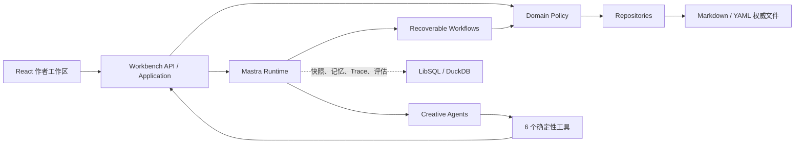

<div align="center">

# ANI 小说 Agent

本地优先、面向中文长篇网文创作的 Mastra Agent 工作区。

把一句模糊想法收束为可执行蓝图，再沿一条可恢复、可审查、保护作者修改的生产链稳定写下去。

[](https://github.com/ExplosiveCoderflome/ani-book-agent/releases/tag/2026-10-15)


[](LICENSE)

</div>

> [!IMPORTANT]
> 当前版本优先保证“从零开书到前三章稳定稿”的可靠闭环。系统支持继续按批续写，但暂不承诺无人值守自动完成整本小说。

## 项目定位

长篇创作的问题通常不是“生成一段文字”，而是持续守住人物状态、世界规则、章节顺序、节奏承诺和作者已经确认的选择。ANI 小说 Agent 把这些职责拆开：

- Agent 负责理解意图、提出方案、写作、诊断与修订判断。
- Mastra Workflow 负责串行执行、重试、暂停恢复、流式状态和可观测性。
- Domain 负责权限、幂等、作者保护、过期检查和合法状态转换。
- Markdown/YAML 负责保存可阅读、可版本化的作品事实。

它更适合：

- 不熟悉网文规划，希望从阅读感觉或一句灵感开始的新手作者。
- 希望作品保存在本地文件中，并保留最终决定权的长期创作者。
- 想研究 Mastra Agent、可恢复 Workflow 和文件型领域模型的开发者。

## 当前可靠闭环

```text
阅读偏好 / 一句灵感 / 公开榜单信号
                ↓
        3 个差异化故事种子
                ↓
       2 份可比较作品蓝图
                ↓
作者确认蓝图、账本、角色与全书张力曲线
                ↓
   卷计划 + 逐章目标曲线 → 作者确认
                ↓
 Writer 写作 → Critic 验收 → 最多 2 次质量重写
                ↓
正文、连续性、新角色与实际张力原子提交
                ↓
      作者编辑 / 项目审查 / TXT 导出
```

开书有两种模式：

| 模式 | 适合场景 | 行为 |
| --- | --- | --- |
| 里程碑协作（默认） | 想参与方向选择和重要确认 | 先给 3 个故事种子，再给 2 份蓝图；作者批准开书资产和卷张力曲线后生成前三章 |
| 全自动开书 | 已在市场趋势卡片中明确选定方向，想快速看到成稿 | 内部比较原创方向，直接创建开书资产并生成第 1—3 章；完成后恢复普通模式，不继续写第 4 章 |

## 现在能做什么

| 能力 | 当前实现 | 安全边界 |
| --- | --- | --- |
| 新手开书 | 从“升级爽感、赚钱经营、智斗破局、关系拉扯、悬疑闯关、给我惊喜”等直觉选项出发，逐步生成种子和蓝图 | 没有作者偏好时不先堆世界观；普通模式下关键方向必须确认 |
| 章节生产 | UI 默认每批续写 3 章，底层单次最多 5 章；严格从 `nextChapter` 串行推进 | 同一本书只能有一个活动任务；未通过独立验收的正文不会稳定提交 |
| 质量闭环 | 独立 Writer 与 Critic；检查连续性、重复、节奏、钩子和实际张力，必要时最多自动重写 2 次 | 不降低验收标准；仍不合格时停止并保留最近稳定章节，可一键重试 |
| 作者工作台 | 文件树、Markdown 可视化/源码编辑、角色状态、张力曲线、Agent 对话、任务状态和逐行差异 | 作者保存的内容自动保护；Agent 只能提交补丁，不能静默覆盖 |
| 项目审查 | 用自然语言要求检查连续性、人物、节奏、伏笔或指定范围，Critic 分批取证并保存 Markdown 报告 | 审查报告不会自动改正文 |
| 市场趋势 | 按需读取番茄、起点、晋江 6 个公开榜单的书名、作者、分类与排名，生成题材信号和阅读感觉卡 | 不读取作品正文，不把排名当成功保证，也不会自动修改现有作品 |
| 长篇拆书 | 导入本地 TXT/Markdown，支持快速/标准/完整预设、章节范围、自定义或 AI 建议的切分规则，再按逐章、阶段、宏观与全书层级分析 | 启动前必须确认切分和 Token 预算；不使用向量库，不联网抓取参考书正文 |
| 结构与机制迁移 | 七大体系、70 维结构雷达；从 1–3 条洞察生成限定章节范围的规划/写作/审查约束 | 只迁移抽象机制，不携带原文证据、专名或情节组合；必须作者批准且不会自动开写 |
| 创作 Skill | 7 个官方 Skill，以及派生、新建、ZIP/HTTPS Git 导入、校验、试运行、发布、版本历史、回滚、归档和作品级绑定 | 任务启动时锁定实际版本；没有隔离 Sandbox 时不向 Agent 暴露脚本执行 |
| 模型恢复 | 瞬时限流、超时和服务端错误最多自动重试 3 次；失败原因会转换为可操作提示 | 无效密钥、模型不存在、上下文超限和作者主动停止不会盲目重试 |

## 快速开始

### 环境要求

- Node.js `22.18.0` 或更高版本；仓库提供 `.nvmrc`。
- pnpm `10.x`。
- 一个可用的 LLM API Key。
- Microsoft Edge（仅运行当前 Playwright E2E 测试时需要）。

Windows 是目前体验最完整的平台，因为模型密钥可使用当前用户范围的 DPAPI 加密持久化。其他系统也可运行，但密钥只保留在当前进程会话中。

### 安装与启动

```powershell
git clone https://github.com/ExplosiveCoderflome/ani-book-agent.git
cd ani-book-agent
corepack enable
pnpm install --frozen-lockfile
pnpm dev
```

启动后打开：

- 作者工作区：<http://127.0.0.1:5175>
- Mastra Studio/API：<http://127.0.0.1:4111>

`pnpm dev` 会同时启动 Mastra 和 Web 工作区。仓库没有 `.env.example`，首次使用不需要复制环境变量文件。

### 配置模型

首次打开页面会自动显示模型设置：

1. 选择 Mastra 模型目录中的提供商，或选择“第三方（OpenAI 兼容）”。
2. 填写 API Key；第三方提供商还需填写通常以 `/v1` 结尾的 Base URL，不要包含 `/chat/completions`。
3. 选择默认模型。默认模型承担聊天、写作与审查，也可单独指定拆书分析模型。
4. 保存后开始创建作品。

第三方提供商需要兼容 `GET /models`。实际可用模型和费用由对应提供商决定，本项目不会代付或隐藏模型调用成本。

### 跑通前三章创作闭环

1. 在“作品”页输入临时书名并新建作品。
2. 凭直觉选择一种阅读感觉；系统只记录你明确点击、选择或反馈的偏好。
3. 从 3 个故事种子中选择、混合或提出修改。
4. 点击“生成两份蓝图”，再用自然语言确认其中一份。
5. 检查 Agent 提交的蓝图、连续性账本、全书张力曲线和角色档案，批准后进入第一卷规划。
6. 调整并保存分卷张力曲线，点击“曲线已确认，继续”。
7. 等待第 1–3 章依次写作、验收和提交；之后可编辑正文、继续下一批或导出 TXT。

想缩短开书步骤时，可先进入“市场趋势”，更新公开榜单并生成方向，再从题材或阅读感觉卡选择“快速开书”或“全自动开书”。

### 前三章之后怎么继续

按“审阅或编辑稳定章节 → 点击续写下一批 3 章 → 用自然语言发起项目审查 → 必要时批准规划修订 → 继续下一批”的循环推进。每一批仍使用同一条串行生产链，并从 `novel-state.yaml` 记录的 `nextChapter` 恢复。

## 作者保护与数据权威

### 谁说了算

- 每本书的 `novel-state.yaml` 是生产进度权威。
- `book/ledger.yaml` 是已确认决定、角色状态、世界规则、开放线索和连续性变化的权威。
- 版本化 Markdown/YAML 是蓝图、角色、卷计划、正文、审查与作者决定的权威载体。
- Mastra Memory、向量召回、Workflow 快照和 Trace 都不是小说事实库。

### 写入保护

- Agent 不能直接写权威文件，只能通过确定性工具提交补丁提案。
- 替换文件必须携带当前 SHA-256；基础版本变化后，旧提案会被判定为过期。
- 作者编辑过的正文、蓝图和其他受保护内容必须展示差异并等待批准。
- 张力曲线支持锁定作者节点；除非作者明确要求整条替换，否则 Agent 必须保留锁定点。
- 章节正文、连续性增量、新角色档案和实际张力在校验后一起提交，避免只更新一半。
- 重复提案幂等处理；Agent 没有删除权威文件的能力。
- 提案原文与批准、拒绝决定保存在本地；被拒绝或内容被篡改的提案不能继续应用。
- 规划确认绑定当前文件版本；任务取消或失败后，旧运行的迟到结果不能继续提交。

### 单书目录

```text
novels/<novel-id>/
├─ novel-state.yaml                    # 生产进度与文件版本权威
├─ book/
│  ├─ blueprint.md                     # 作品蓝图
│  ├─ ledger.yaml                      # 连续性账本
│  ├─ tension-curve.yaml               # 全书目标张力
│  └─ characters/*.md                  # 独立角色档案
├─ volumes/
│  ├─ volume-001.md                    # 分卷计划与章节卡
│  └─ volume-001-tension.yaml          # 分卷目标张力
├─ chapters/chapter-001.md             # 稳定章节
├─ workspace/
│  ├─ ideas.md                         # 灵感便笺
│  ├─ skill-bindings.yaml              # 本书 Skill 绑定
│  ├─ proposals/*.yaml                 # 补丁原文与作者审批决定
│  ├─ reviews/*.md                     # 项目审查报告
│  ├─ references/adaptations/*.yaml    # 作者审批的机制迁移提案
│  └─ analysis/*-tension-actual.yaml   # 实际张力与异常诊断
└─ exports/*.txt                       # 导出文件
```

### 默认数据位置

| 目录 | 内容 | Git 默认行为 |
| --- | --- | --- |
| `novels/` | 每本作品的权威 Markdown/YAML | 忽略作品内容，仅保留 `.gitkeep` |
| `reference-library/` | 原文、切分清单、历次分析、证据与角色档案 | 忽略内容，仅保留 `.gitkeep` |
| `.runtime/` | 模型设置、加密密钥、Mastra LibSQL 和 DuckDB 观测数据 | 忽略 |
| `profiles/` | 作者明确提交的选择、喜欢与不喜欢 | 忽略本地数据 |
| `market-radar/` | 最近一次公开榜单快照与 AI 方向总结 | 忽略本地数据 |
| `.mastra/`、`dist/` | 开发/构建产物 | 忽略 |

> [!CAUTION]
> 拆书库会长期保留导入原文和历次分析，直到用户显式删除。请只导入自己创作、已获授权或法律允许处理的文本，不要提交包含私密作品、API Key 或个人偏好的本地数据。

## 拆书与市场数据边界

这两项能力采用不同的数据策略：

- “拆书库”只读取用户主动导入的 `.txt`、`.md`、`.markdown` 文件，支持 UTF-8/GB18030，单文件为 1 字节至 20MiB；不会自行联网获取小说正文。
- “市场趋势”只在用户点击更新时访问预设公开榜单页面，保存可公开查看的排名元数据与来源链接；页面结构变化时允许单个来源失败，不伪造数据。
- 拆书结果和市场总结都只是创作参考。应用到作品时仍须经过原创性约束、当前作品上下文和作者批准。

## 架构



Mastra 是唯一 Agent 与 Workflow Runtime；项目不会再引入第二套 Agent 循环、模型路由器、记忆框架或追踪存储。

### Agent 职责

| Agent | 职责 | 约束 |
| --- | --- | --- |
| `novel-agent` | 对话、探索、创作判断与工具选择 | 有受限记忆，只能使用 6 个确定性工具 |
| `novel-writer` | 卷规划、章节正文与质量重写 | 无工具、无聊天记忆，只消费调用方提供的权威上下文 |
| `novel-critic` | 独立章节验收、事实抽取、实际张力与项目审查 | 无写入工具，不直接改作品 |
| `deconstruction-agent` | 拆书提取、聚合、复核与角色深研 | 无记忆、无工具，只在拆书 Workflow 内运行 |
| `market-radar-agent` | 从公开榜单快照提炼题材信号和阅读感觉 | 只分析已保存的元数据，不决定作品方向 |

### Workflow 职责

- `novel-production`：章节写作、通用项目审查与 TXT 导出。
- `reference-deconstruction`：逐章、阶段、宏观、全书和证据复核。
- `reference-character-profile`：按需生成参考书角色深研档案。
- `market-radar`：更新公开榜单元数据快照。
- `market-radar-summary`：生成题材观察和快速开书卡片。

### 七个官方创作 Skill

`discovery`、`blueprint`、`character-planning`、`volume-planning`、`chapter-writing`、`critique`、`project-review`。

Skill 是可版本化的方法资产，不是第二套 Runtime。Workflow 启动时会锁定实际 Skill 版本、作者偏好版本、机制迁移版本和 `novel-state` 哈希，运行中的任务不会因后续编辑而漂移。

## 技术栈与目录

| 层级 | 技术 |
| --- | --- |
| Web | React 19、Vite 8、React Router、TanStack Query、MDXEditor |
| Agent / Workflow | Mastra |
| 领域合同 | TypeScript、Zod 4 |
| 权威作品数据 | Markdown、YAML、SHA-256 |
| 运行与观测存储 | LibSQL、DuckDB |
| 测试 | Node.js Test Runner、Playwright |

```text
src/
├─ domain/          # 状态、Schema、权限、幂等与领域规则；不依赖 Mastra
├─ application/     # 用例服务、端口与错误合同
├─ infrastructure/  # 文件仓库、模型设置、Skill 与本地数据适配
├─ mastra/          # Agent、Workflow、Tool、Prompt、Skill 与组合根
├─ shared/          # Web/API 共享合同
└─ web/             # React 作者工作区
test/               # 领域、应用、架构、工作流与 E2E 测试
docs/               # ADR、架构说明、路线图与更新记录
scripts/            # Mastra 开发/构建保护脚本
```

依赖方向固定为：`Web / Mastra / Infrastructure → Application → Domain`。Domain 模块不得导入 Mastra。

## 开发与验证

| 命令 | 用途 |
| --- | --- |
| `pnpm dev` | 同时启动 Mastra Studio/API 与作者工作区 |
| `pnpm dev:studio` | 只启动 Mastra；启动前隔离旧构建产物 |
| `pnpm dev:web` | 只启动 Vite；业务 API 仍需要 Mastra 服务 |
| `pnpm test` | 运行 Node.js 单元/集成测试 |
| `pnpm test:e2e` | 用 Microsoft Edge 运行 Playwright E2E |
| `pnpm typecheck` | TypeScript 静态检查 |
| `pnpm build:web` | 构建 Web 到 `dist/web` |
| `pnpm build` | 构建 Mastra 与 Studio 到 `.mastra/output` |
| `pnpm check` | 依次运行测试、E2E、类型检查和两类构建 |

构建前请先停止仍在运行的 `pnpm dev`。预构建脚本会拒绝覆盖正在被 Mastra 开发进程使用的输出目录。

本次发布已验证 173 项单元/集成测试、16 项 E2E、类型检查、Web 与 Mastra 构建，以及构建后 API 审批流程全部通过。

### 可选环境变量

常规使用无需设置这些变量；模型与密钥优先通过页面配置。

| 变量 | 默认值 / 作用 |
| --- | --- |
| `MASTRA_PORT` | Mastra 端口，默认 `4111`；Vite 代理会读取同一值 |
| `ANI_NOVEL_PROJECT_DIR` | `novels/`、`profiles/`、`market-radar/` 和模型设置的基准目录 |
| `ANI_REFERENCE_LIBRARY_DIR` | 将全局拆书库移到指定目录 |
| `ANI_NOVEL_DATA_DIR` | Mastra 运行与观测数据库目录，默认 `.runtime/` |
| `MASTRA_DB_URL` | 高级用法：覆盖 LibSQL URL |
| `MASTRA_OBSERVABILITY_DB_PATH` | 高级用法：覆盖 DuckDB 文件路径 |
| `ANI_SKILL_SANDBOX_PROVIDER` | 设为 `remote` 时声明已配置受支持的远程 Skill Sandbox |

## 最新更新

### 2026-10-15

- 优化：提案审批持久保存，规划确认绑定当前版本，章节通过独立验收后才能推进进度。
- 修复：并发保存丢失、提交中断后文件与进度不一致、作者文件被覆盖，以及取消后旧任务继续写入的问题。
- 修复：首次全自动开书的 Skill 初始化失败、拆书任务竞争和自定义章节规则阻塞服务的问题。

升级前的活动任务需取消后重启，未登记的历史待审批提案需重新生成；已有正文无需迁移。

完整更新历史见 [docs/releases/release-notes.md](docs/releases/release-notes.md)。

## 当前边界与非目标

- 当前自动化承诺止于前三章开书；后续可按批续写，但“无需作者照看就完成整本书”仍是待提升目标。
- 当前是本地单用户开发应用，没有桌面安装包、云端多用户协作或托管服务。
- 不使用 Qdrant/RAG；参考书原文、Memory 和向量召回不会成为作品事实来源。
- 市场趋势依赖第三方公开页面结构，来源可能临时不可访问或因页面改版失效。
- 未配置受支持的隔离 Sandbox 时，Skill 的脚本可以保存和发布，但不会交给 Agent 执行。
- 构建脚本只产出 Web 与 Mastra 构建结果，仓库目前没有合并后的生产启动或部署脚本。

下一阶段优先提高更长批次与整本续写的恢复可靠性，补齐隔离 Sandbox、Skill 试运行 Trace，以及人物弧、伏笔回收、节奏和连续性方法。

## 常见问题

<details>
<summary><strong>它能自动写完整本小说吗？</strong></summary>

还不能。全自动开书只负责开书资产和第 1–3 章；之后回到普通模式，由作者按批推进、审查和调整。

</details>

<details>
<summary><strong>需要安装数据库或 Qdrant 吗？</strong></summary>

不需要。权威创作数据是本地 Markdown/YAML；Mastra 的运行和观测数据使用项目内嵌的 LibSQL 与 DuckDB。当前没有向量数据库依赖。

</details>

<details>
<summary><strong>任务失败后从哪里恢复？</strong></summary>

先看作品页底部的任务栏：已经稳定提交的章节不会丢失。可恢复错误可以点击“一键重试”，系统会从当前 `nextChapter` 继续；如果正在等待张力曲线确认，先保存曲线再点击继续；密钥或模型配置错误则先到模型设置修正。

</details>

<details>
<summary><strong>Agent 会覆盖我改过的正文吗？</strong></summary>

不会静默覆盖。作者保存后文件进入保护状态，Agent 必须提交带基础哈希的补丁，并展示逐行差异等待批准。

</details>

<details>
<summary><strong>第三方模型为什么获取不到列表？</strong></summary>

确认 Base URL 通常以 `/v1` 结尾且不包含 `/chat/completions`，API Key 有权访问 `GET /models`。如果厂商不提供兼容的模型列表接口，当前设置页无法完成自动发现。

</details>

<details>
<summary><strong>为什么拆书说“不联网”，市场趋势却需要联网？</strong></summary>

“不联网”只描述拆书库：它不会抓取参考小说正文。市场趋势是独立、由用户主动触发的功能，只读取公开榜单元数据和来源链接。

</details>

## 设计参考与项目关系

本项目在“面向新手、优先提高长篇完成率”的产品问题上研究了 [AI-Novel-Writing-Assistant](https://github.com/ExplosiveCoderflome/AI-Novel-Writing-Assistant)，但它是独立的 Mastra 实现，不是参考项目的运行时组件，也不依赖或复制其 LangGraph、RAG、数据库 Schema、桌面端和衍生工坊。

架构决策见 [ADR 0001：采用 Mastra](docs/adr/0001-adopt-mastra.md)，完整版本记录见 [docs/releases/release-notes.md](docs/releases/release-notes.md)。

## 贡献

欢迎通过 [Issue](https://github.com/ExplosiveCoderflome/ani-book-agent/issues) 或 Pull Request 反馈。提交代码时请保持这些约束：

- Mastra 是唯一 Agent/Workflow Runtime。
- 领域层不依赖 Mastra，AI 输出必须经过确定性校验后才能提交。
- 不覆盖作者保护内容，不把记忆或向量召回当作小说事实。
- 每个非平凡领域规则至少留下一个最小可运行测试。

提交前建议运行：

```powershell
pnpm check
```

## License

本项目采用 [Apache License 2.0](LICENSE)。
